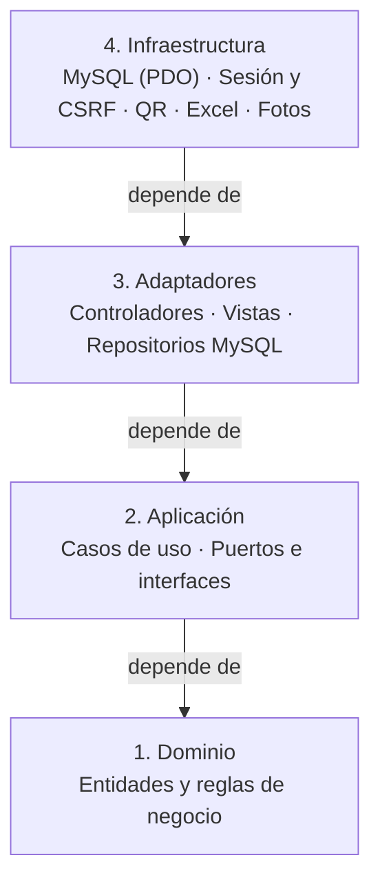

# Rumbo al Cielo

Sistema para reservar almuerzos con pensión mensual, entrega con código QR y liquidación mensual.
Realizado en PHP puro con MySQL, siguiendo Arquitectura Limpia capas.

## Documentación (carpeta `doc/`)

| Etapa | Archivo |
|---|---|
| Backlog | `doc/backlong RunboC` (28 historias de usuario) |
| Casos de uso y clases | `doc/ISW.drawio` |
| Pruebas | `doc/reporte_pruebas.png` |
| Uso de IA | `doc/bitacora.md` y `doc/declaracion_uso_ia.md` |

## Arquitectura

El código está en cuatro capas. Cada capa solo depende de la que está debajo, y todas apuntan al dominio.



| Capa | Carpeta | Qué tiene |
|---|---|---|
| Dominio | `src/Dominio` | Entidades del diagrama de clases, enumeraciones, excepciones y `Reloj` |
| Aplicación | `src/Aplicacion` | Casos de uso, puertos e interfaces de repositorio |
| Adaptadores | `src/Adaptadores` | Controladores, vistas y repositorios MySQL |
| Infraestructura | `src/Infraestructura` | Conexión a la base, sesión, QR, generador de `.xlsx` y fotos |

- El dominio y los casos de uso no conocen MySQL ni la sesión. Usan interfaces y la capa de afuera las implementa.
- Los controladores solo leen la petición, llaman al caso de uso y muestran el resultado.
- Los casos de uso validan antes de guardar. La hora sale de `Reloj`, así se prueba el corte de las 09:00.

**Decisión de diseño:** el cálculo de la liquidación (15 Bs por almuerzo de pensionado, 150 Bs de penalidad
si consumió menos de 10, 18 Bs en modalidad diaria) está en la entidad `DetalleLiquidacion`, no en el
controlador. Así se prueba sin base de datos.
## Los siete módulos

| Módulo | Historias | Qué hace |
|---|---|---|
| Usuarios | HU-01, 02, 03, 05, 06 | Inicio y cierre de sesión, bloqueo por intentos, recuperar contraseña, alta, baja y reincorporación |
| Familiares | HU-04, 07 | Registrar, editar y eliminar familiares de un empleado |
| Pensiones | HU-08 a 11 | Solicitar, confirmar, rechazar y revocar la pensión mensual |
| Platos | HU-12 | Registrar y editar el plato de cada día con fotos |
| Menú | HU-13 a 15 | Armar y publicar el menú semanal, ver el menú y registrar feriados |
| Reservas | HU-16 a 22, 28 | Reservar y cancelar, calendario, código QR, validar entrega y consulta del administrador |
| Reportes | HU-23 a 27 | Tablero del día, lista diaria, exportar reservas, liquidación mensual y planilla `.xlsx` |

Reglas principales: se atiende de lunes a jueves; se reserva y se cancela solo antes de las 09:00 del día
del almuerzo; la tarifa es 18 Bs (diaria) o 15 Bs (pensionado); el empleado también reserva para sus
familiares; cada reserva tiene un código QR único; el almuerzo reservado y no retirado se cobra.

## Cómo ejecutar

Se necesita PHP 8.2 o superior (con `pdo_mysql`, `mbstring` y `zip`), MySQL y Composer.

```bash
composer install
```

1. Ejecutar `database/schema.sql` en MySQL. Crea la base `rumbo_al_cielo` y sus tablas.
2. Crear un archivo `.env` en la raíz con los datos de conexión:
   ```
   DB_HOST=127.0.0.1
   DB_PUERTO=3306
   DB_NOMBRE=rumbo_al_cielo
   DB_USUARIO=root
   DB_CLAVE=
   ```
3. Levantar el servidor:
   ```bash
   php -S localhost:8000 -t public
   ```
4. Abrir <http://localhost:8000> e iniciar sesión con el administrador que está en la base de datos.

**Modo demostración (opcional):** el servicio es de lunes a jueves y las reservas cierran a las 09:00, así que
para probar un fin de semana o fuera de hora se puede fijar la hora sin tocar el código. En Windows (cmd),
desde la carpeta del proyecto:

```bash
set RELOJ_DEMO=2026-11-16 08:30
php -d auto_prepend_file="%cd%\scripts\reloj_demo.php" -S localhost:8000 -t public
```

## Pruebas

```bash
php vendor/bin/phpunit
```

Las pruebas de `tests/Aplicacion` ejecutan los casos de uso con repositorios en memoria (`tests/Dobles`), sin
base de datos. Cada historia tiene al menos una prueba y el nombre indica el criterio que verifica.
Última ejecución: 144 pruebas, 417 aserciones, todo en verde (`doc/reporte_pruebas.png`).

## Estructura

```
src/
  Dominio/          entidades, enumeraciones, excepciones, Reloj
  Aplicacion/       CasosDeUso/, Puertos/, Repositorios/ (interfaces)
  Adaptadores/      Controladores/, Vistas/, Repositorios/ (MySQL), Archivos/
  Infraestructura/  BaseDeDatos/, Sesion/, Seguridad/, Qr/, Excel/, Archivos/
public/             index.php (rutas), css/, js/
tests/              Aplicacion/ (pruebas), Dobles/ (repositorios en memoria)
database/           schema.sql
scripts/            reloj_demo.php
doc/                backlog, diagramas, bitácora y declaración de uso de IA
```

## Limitaciones

- El aviso al administrador de una reserva nueva (HU-20) y el aviso de plato modificado (HU-12, criterio 3)
  se generan como eventos del dominio, pero todavía no hay una bandeja de notificaciones en pantalla.
- La lectura del QR con cámara depende de que el navegador soporte `BarcodeDetector`. También se puede
  escribir el código a mano o usar un lector USB.